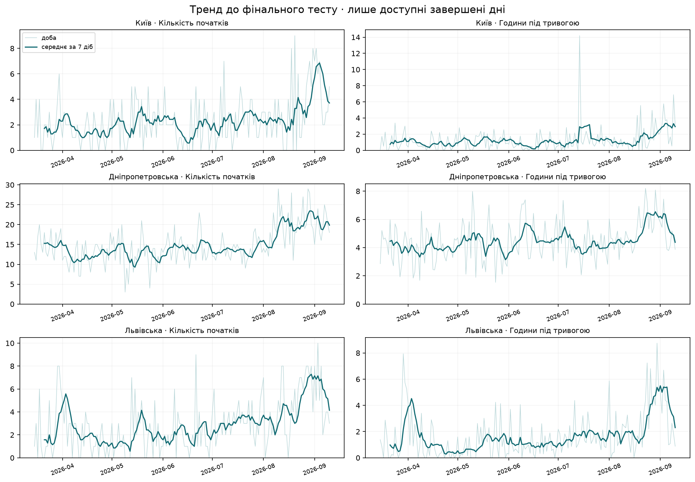
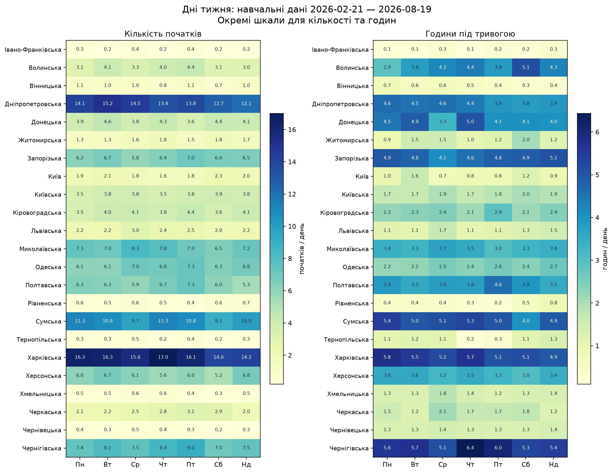
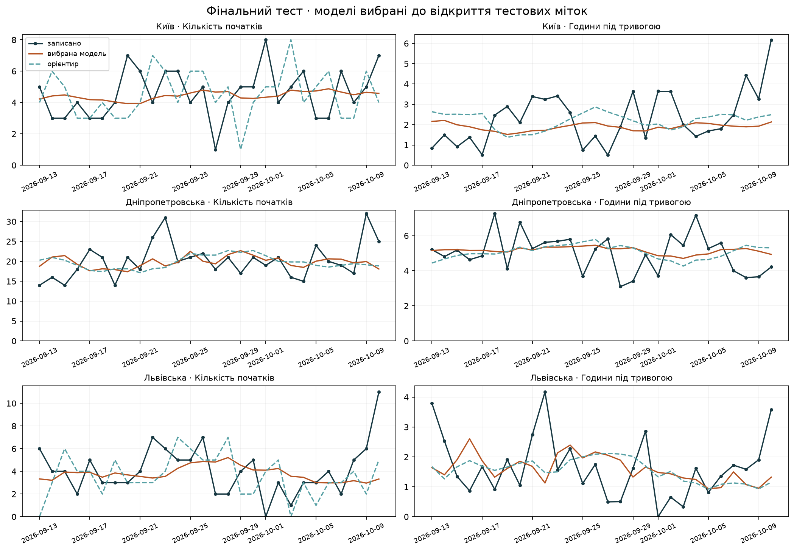
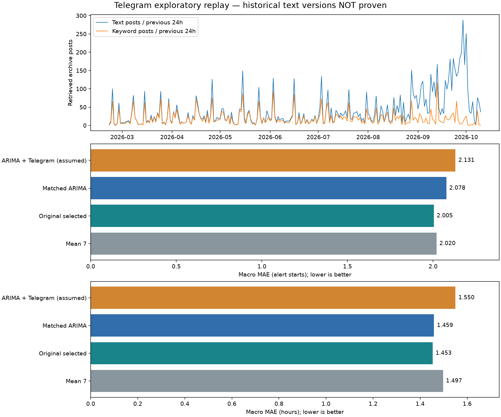

# Аналіз і прогнозування зареєстрованих повітряних тривог

## Результат базової версії

Щодня о 00:00 Europe/Kyiv прогнозуємо добу, що починається в цей момент: інтервал [D 00:00, D+1 00:00). Через затримку даних це зазвичай прогноз на **післязавтра відносно останньої готової доби**. Тест: **2026-09-13 — 2026-10-10**; 23 регіони, 643 придатні регіональні дні для кожної цілі. Вибір моделей: 2026-08-21 — 2026-09-10.

Основне явне порівняння — із середнім останніх семи доступних готових днів (mean_7) в усіх регіонах. Кількість: покращення MAE **0.77%**. Години: **2.95%**. Поріг 5% проти цього орієнтира не досягнуто для обох цілей. Обрана модель — вибір між ARIMA та експоненційним згладжуванням окремо для регіону й цілі; це не результат однієї ARIMA для всіх регіонів. Для кількості RMSE обраної моделі 2.591, проти 2.584 у mean_7, тобто за цією метрикою модель трохи гірша.

| Ціль | MAE середнього 7 днів | MAE моделі | Покращення, % | Поріг 5% проти mean_7 |
| --- | --- | --- | --- | --- |
| Кількість початків | 2.020 | 2.005 | 0.771 | не пройдено |
| Години під тривогою | 1.497 | 1.453 | 2.947 | не пройдено |

## З яким орієнтиром порівнюємо

Попередні 9.19% для кількості — точний результат проти орієнтира, обраного за валідацією окремо для кожного регіону: last у 8 регіонах і mean_7 у 15. Для годин: last у 3, mean_7 у 18, weekly_naive у 2. Це не порівняння тільки з правилом «як учора», проте така загальна цифра приховувала значно менший виграш проти єдиного mean_7. Тепер усі варіанти показано поруч. last означає останній **готовий** день, який через затримку може бути позавчорашнім.

mean_7 використовує сім останніх готових добових значень, доступних до origin. Для годин усереднюється частка доби, яка множиться на 23/24/25 годин цільової доби. Останні сім календарних днів до origin можуть містити неготову добу, тому майбутні чи ще не опубліковані значення не використовуються. Усі порівняння мають однакові регіони, дати, origin, мітки та доступність. Відсоток = 100 × (MAE орієнтира − MAE моделі) / MAE орієнтира.

Явне порівняння mean_7 додано за запитом користувача після відкриття тесту; прогнози mean_7 вже існували в замороженому експерименті. Початковий протокол і критерій проти validation_selected_baseline збережено, новий критерій не видається за заздалегідь погоджений. Моделі, параметри й тестові дати не змінювалися. [Порівняння орієнтирів](baseline_comparison.csv) · [за регіонами](baseline_comparison_by_region.csv) · [окремі ARIMA, SARIMA, SES, ETS та орієнтири](test_macro_all_models.csv) · [склад початкового орієнтира](baseline_selection_summary.csv).

| Ціль | Орієнтир | MAE орієнтира | MAE обраної моделі | Покращення, % |
| --- | --- | --- | --- | --- |
| Кількість початків | last | 2.546 | 2.005 | 21.256 |
| Кількість початків | mean_7 | 2.020 | 2.005 | 0.771 |
| Кількість початків | validation_selected_baseline | 2.207 | 2.005 | 9.188 |
| Кількість початків | weekly_naive | 2.571 | 2.005 | 22.020 |
| Години під тривогою | last | 1.840 | 1.453 | 21.034 |
| Години під тривогою | mean_7 | 1.497 | 1.453 | 2.947 |
| Години під тривогою | validation_selected_baseline | 1.467 | 1.453 | 0.951 |
| Години під тривогою | weekly_naive | 1.915 | 1.453 | 24.124 |

## Дані й аномалії

Основне джерело — [волонтерський датасет](https://github.com/Vadimkin/ukrainian-air-raid-sirens-dataset/tree/bf0c323c78e3e4508721458797dcd38c95df13f3). Зафіксовано SHA `bf0c323c78e3e4508721458797dcd38c95df13f3`; підтверджена доступність не пізніше 2026-10-11T04:50:19Z. Файл містить 115,989 записів від 2022-02-25T16:36:22+00:00 до останнього початку 2026-10-11T04:36:59+00:00. Останнє завершення: 2026-10-11T04:46:11+00:00. Щоденний commit сам собою не підтверджує актуальність кожного регіону.

Точних дублікатів немає. Дублікат тут означає збіг усіх чотирьох полів: region, started_at, finished_at, naive, включно з роком і секундою. Однакова тривалість або день місяця в різні роки не є дублікатом.

5,812 записів naive=True: завершення через 30 хвилин встановили автори джерела. Ці інтервали залишено без змін і включено до годин. Є 6 нульових і 14 інтервалів понад 24 години; найдовший 178.265 год. Їх автоматично не вилучено: довгий інтервал може бути реальною подією або помилкою джерела. [Перелік аномалій](source_duration_anomalies.csv).

Джерело має 25 географічних одиниць: 24 області та Київ; Криму немає. Виключено: Закарпатська область, Луганська область. Для допуску використано активність джерела: щонайменше два різні дні з початками за минулі 30 днів та свіжий snapshot. **Це практичний індикатор доступності, він не підтверджує повноти всіх реальних тривог.** Дні без записаних початків умовно прийнято за нуль у допущених рядах. Окремого незалежного журналу всіх пропусків немає; тому цілі стосуються зареєстрованої історії, а не гарантовано всіх подій. [Покриття](coverage.csv).

## Добові ряди

Кількість — число початків у межах київської календарної доби. Години — довжина об'єднання записаних інтервалів у цьому регіоні в межах доби. Перетини не подвоюють час, інтервали через північ розділено. Межі напіввідкриті [початок, кінець). Тривалість доби обчислюється через UTC і становить 23/24/25 годин.

Незавершений active-інтервал блокує мітки від дня його початку до наявного snapshot. Йому не вигадується час завершення. Це окремий випадок від уже завершених naive=True, де правило 30 хвилин збережено. Неготові тестові регіональні доби: Івано-Франківська область, 2026-10-10. Їх виключено для обох цілей й усіх моделей. [Статуси міток](test_label_status.csv). Нулі для днів без записів залежать від припущення про покриття вище.

## Доступність даних і захист від витоку

Відтворено 100 щоденних Git-версій. Для кожної версії перевірено blob SHA та відповідний успішний GitHub Actions run. Верхня межа публікації — завершення run після commit і push, зі звіркою parent SHA. Для найпершої shallow-версії parent не доступний; використано єдиний відповідний часовий інтервал run. [Маніфест версій](../data/snapshots.json). Початкові історичні рядки консервативно доступні тільки з 2026-07-04T03:28:41Z.

На кожен прогноз береться остання вже опублікована версія, а не сучасний CSV, обрізаний за датою події. Навчання — до 180 доступних завершених днів, мінімум 60. Наприклад, **1 жовтня 2026 о 00:00** остання готова доба — **29 вересня**. Крок 1 — прогноз на 30 вересня; крок 2 — цільовий прогноз на **1 жовтня, 00:00–24:00**. Це «післязавтра» відносно 29 вересня та найближча доба від моменту запуску. День запуску й дата цілі збігаються. Прогалину 30 вересня модель проходить власним прогнозом, фактичне значення не підставляється. Якщо через незавершені інтервали остання готова мітка ще давніша, горизонт від неї більший: у цьому експерименті 2–6 календарних добових кроків. [Дати й межі кожного прогнозу](forecast_timing.csv) · [аудит часової схеми](timing_audit.json).

Валідаційні мітки взято з версії, доступної 2026-09-12T03:48:54Z, до початку тесту. Є триденний календарний буфер. Сімейство/сезонність і орієнтир вибрано за MAE, далі RMSE, потім назвою моделі. Вибір зафіксовано перед тестовими мітками; щоденне перенавчання на новому минулому дозволене. Тест не використано для повторного налаштування. Чотири прогнози валідації пропущено через індикатор покриття; усі моделі порівнюються на однакових доступних днях.

## Тренди та опис історії

Нижче — приклади історії для Києва, Дніпропетровщини та Львівщини до фінального тесту. У CSV є зміни середніх за останні й попередні 30 днів для всіх 23 регіонів. Зміни можуть відображати як характер подій, так і роботу джерела; причинні пояснення з одного ряду не випливають. [Таблиця трендів](trend_comparison.csv).

## Дні тижня та ACF

Одна фігура, дві панелі: середні початки та години, понеділок–неділя для всіх регіонів. Навчальний період 2026-02-21 — 2026-08-19, до першої валідації. [Таблиця відмінностей](weekday_differences.csv) містить n, середнє, медіану та різницю із загальним середнім регіону для кожної цілі.

[ACF кількості](figures/acf_count.png) · [ACF годин](figures/acf_hours.png) · [Числа ACF](acf.csv). Перед ACF вилучено лінійний тренд; лаги 7, 14 і 21 позначено. Межі 95% поточкові, орієнтовні, без поправки на багато порівнянь; окремий пік не є доказом сезонності. STL не застосовується.

Щонайменше одна сезонна модель зменшила валідаційний MAE на 5% у 4 регіонах для кількості й 3 для годин. Поєднання такого покращення з додатною ACF7 поза орієнтовною межею є лише у 0 та 0 регіонах відповідно. Однієї спільної стійкої тижневої закономірності для всіх регіонів не встановлено. Висновки нижче є дослідницькими; причинного впливу дня тижня не доведено.

| region | target | family | nonseasonal_mae | seasonal_mae | conclusion |
| --- | --- | --- | --- | --- | --- |
| Івано-Франківська область | Кількість початків | ARIMA | 0.246 | 0.253 | переконливої користі сезонності не виявлено |
| Івано-Франківська область | Кількість початків | Exponential smoothing | 0.181 | 0.161 | сезонність покращує прогноз, ACF не дає переконливого підтвердження |
| Івано-Франківська область | Години під тривогою | ARIMA | 0.159 | 0.170 | переконливої користі сезонності не виявлено |
| Івано-Франківська область | Години під тривогою | Exponential smoothing | 0.065 | 0.093 | переконливої користі сезонності не виявлено |
| Волинська область | Кількість початків | ARIMA | 1.571 | 1.571 | переконливої користі сезонності не виявлено |
| Волинська область | Кількість початків | Exponential smoothing | 1.692 | 1.777 | переконливої користі сезонності не виявлено |
| Волинська область | Години під тривогою | ARIMA | 2.145 | 2.214 | переконливої користі сезонності не виявлено |
| Волинська область | Години під тривогою | Exponential smoothing | 2.147 | 2.046 | переконливої користі сезонності не виявлено |
| Вінницька область | Кількість початків | ARIMA | 1.938 | 2.012 | переконливої користі сезонності не виявлено |
| Вінницька область | Кількість початків | Exponential smoothing | 1.772 | 1.695 | переконливої користі сезонності не виявлено |
| Вінницька область | Години під тривогою | ARIMA | 0.824 | 0.860 | переконливої користі сезонності не виявлено |
| Вінницька область | Години під тривогою | Exponential smoothing | 0.822 | 0.818 | переконливої користі сезонності не виявлено |
| Дніпропетровська область | Кількість початків | ARIMA | 3.796 | 3.911 | переконливої користі сезонності не виявлено |
| Дніпропетровська область | Кількість початків | Exponential smoothing | 3.425 | 3.421 | переконливої користі сезонності не виявлено |
| Дніпропетровська область | Години під тривогою | ARIMA | 1.697 | 1.592 | сезонність покращує прогноз, ACF не дає переконливого підтвердження |
| Дніпропетровська область | Години під тривогою | Exponential smoothing | 1.352 | 1.427 | переконливої користі сезонності не виявлено |
| Донецька область | Кількість початків | ARIMA | 1.459 | 1.456 | переконливої користі сезонності не виявлено |
| Донецька область | Кількість початків | Exponential smoothing | 1.444 | 1.518 | переконливої користі сезонності не виявлено |
| Донецька область | Години під тривогою | ARIMA | 1.656 | 1.647 | переконливої користі сезонності не виявлено |
| Донецька область | Години під тривогою | Exponential smoothing | 1.496 | 1.731 | переконливої користі сезонності не виявлено |
| Житомирська область | Кількість початків | ARIMA | 1.997 | 1.983 | переконливої користі сезонності не виявлено |
| Житомирська область | Кількість початків | Exponential smoothing | 1.849 | 1.799 | переконливої користі сезонності не виявлено |
| Житомирська область | Години під тривогою | ARIMA | 0.921 | 0.907 | переконливої користі сезонності не виявлено |
| Житомирська область | Години під тривогою | Exponential smoothing | 1.149 | 1.229 | переконливої користі сезонності не виявлено |
| Запорізька область | Кількість початків | ARIMA | 1.729 | 1.724 | переконливої користі сезонності не виявлено |
| Запорізька область | Кількість початків | Exponential smoothing | 1.729 | 1.739 | переконливої користі сезонності не виявлено |
| Запорізька область | Години під тривогою | ARIMA | 0.882 | 0.870 | переконливої користі сезонності не виявлено |
| Запорізька область | Години під тривогою | Exponential smoothing | 0.918 | 1.042 | переконливої користі сезонності не виявлено |
| Київ | Кількість початків | ARIMA | 2.702 | 2.668 | переконливої користі сезонності не виявлено |
| Київ | Кількість початків | Exponential smoothing | 2.497 | 2.538 | переконливої користі сезонності не виявлено |
| Київ | Години під тривогою | ARIMA | 1.660 | 1.689 | переконливої користі сезонності не виявлено |
| Київ | Години під тривогою | Exponential smoothing | 1.686 | 1.725 | переконливої користі сезонності не виявлено |
| Київська область | Кількість початків | ARIMA | 4.036 | 4.142 | переконливої користі сезонності не виявлено |
| Київська область | Кількість початків | Exponential smoothing | 4.291 | 4.319 | переконливої користі сезонності не виявлено |
| Київська область | Години під тривогою | ARIMA | 0.765 | 0.766 | переконливої користі сезонності не виявлено |
| Київська область | Години під тривогою | Exponential smoothing | 0.826 | 0.819 | переконливої користі сезонності не виявлено |
| Кіровоградська область | Кількість початків | ARIMA | 2.195 | 2.222 | переконливої користі сезонності не виявлено |
| Кіровоградська область | Кількість початків | Exponential smoothing | 2.160 | 2.201 | переконливої користі сезонності не виявлено |
| Кіровоградська область | Години під тривогою | ARIMA | 1.803 | 1.782 | переконливої користі сезонності не виявлено |
| Кіровоградська область | Години під тривогою | Exponential smoothing | 1.786 | 1.799 | переконливої користі сезонності не виявлено |
| Львівська область | Кількість початків | ARIMA | 2.330 | 2.340 | переконливої користі сезонності не виявлено |
| Львівська область | Кількість початків | Exponential smoothing | 2.262 | 2.362 | переконливої користі сезонності не виявлено |
| Львівська область | Години під тривогою | ARIMA | 1.893 | 1.891 | переконливої користі сезонності не виявлено |
| Львівська область | Години під тривогою | Exponential smoothing | 1.822 | 1.798 | переконливої користі сезонності не виявлено |
| Миколаївська область | Кількість початків | ARIMA | 2.106 | 2.135 | переконливої користі сезонності не виявлено |
| Миколаївська область | Кількість початків | Exponential smoothing | 1.815 | 1.787 | переконливої користі сезонності не виявлено |
| Миколаївська область | Години під тривогою | ARIMA | 1.468 | 1.496 | переконливої користі сезонності не виявлено |
| Миколаївська область | Години під тривогою | Exponential smoothing | 1.180 | 1.171 | переконливої користі сезонності не виявлено |
| Одеська область | Кількість початків | ARIMA | 2.720 | 2.663 | переконливої користі сезонності не виявлено |
| Одеська область | Кількість початків | Exponential smoothing | 2.595 | 2.687 | переконливої користі сезонності не виявлено |
| Одеська область | Години під тривогою | ARIMA | 0.885 | 0.901 | переконливої користі сезонності не виявлено |
| Одеська область | Години під тривогою | Exponential smoothing | 0.960 | 0.967 | переконливої користі сезонності не виявлено |
| Полтавська область | Кількість початків | ARIMA | 1.822 | 1.821 | переконливої користі сезонності не виявлено |
| Полтавська область | Кількість початків | Exponential smoothing | 1.880 | 1.968 | переконливої користі сезонності не виявлено |
| Полтавська область | Години під тривогою | ARIMA | 1.017 | 0.994 | переконливої користі сезонності не виявлено |
| Полтавська область | Години під тривогою | Exponential smoothing | 1.066 | 1.176 | переконливої користі сезонності не виявлено |
| Рівненська область | Кількість початків | ARIMA | 0.948 | 0.966 | переконливої користі сезонності не виявлено |
| Рівненська область | Кількість початків | Exponential smoothing | 0.909 | 0.919 | переконливої користі сезонності не виявлено |
| Рівненська область | Години під тривогою | ARIMA | 0.343 | 0.343 | переконливої користі сезонності не виявлено |
| Рівненська область | Години під тривогою | Exponential smoothing | 0.334 | 0.382 | переконливої користі сезонності не виявлено |
| Сумська область | Кількість початків | ARIMA | 2.625 | 2.614 | переконливої користі сезонності не виявлено |
| Сумська область | Кількість початків | Exponential smoothing | 2.624 | 2.465 | сезонність покращує прогноз, ACF не дає переконливого підтвердження |
| Сумська область | Години під тривогою | ARIMA | 1.856 | 1.822 | переконливої користі сезонності не виявлено |
| Сумська область | Години під тривогою | Exponential smoothing | 1.855 | 1.856 | переконливої користі сезонності не виявлено |
| Тернопільська область | Кількість початків | ARIMA | 0.502 | 0.481 | переконливої користі сезонності не виявлено |
| Тернопільська область | Кількість початків | Exponential smoothing | 0.510 | 0.478 | сезонність покращує прогноз, ACF не дає переконливого підтвердження |
| Тернопільська область | Години під тривогою | ARIMA | 5.806 | 5.828 | переконливої користі сезонності не виявлено |
| Тернопільська область | Години під тривогою | Exponential smoothing | 6.159 | 6.145 | переконливої користі сезонності не виявлено |
| Харківська область | Кількість початків | ARIMA | 2.959 | 2.953 | переконливої користі сезонності не виявлено |
| Харківська область | Кількість початків | Exponential smoothing | 2.839 | 3.119 | переконливої користі сезонності не виявлено |
| Харківська область | Години під тривогою | ARIMA | 0.861 | 0.819 | переконливої користі сезонності не виявлено |
| Харківська область | Години під тривогою | Exponential smoothing | 0.881 | 0.832 | сезонність покращує прогноз, ACF не дає переконливого підтвердження |
| Херсонська область | Кількість початків | ARIMA | 1.884 | 1.864 | переконливої користі сезонності не виявлено |
| Херсонська область | Кількість початків | Exponential smoothing | 1.825 | 1.837 | переконливої користі сезонності не виявлено |
| Херсонська область | Години під тривогою | ARIMA | 1.283 | 1.306 | переконливої користі сезонності не виявлено |
| Херсонська область | Години під тривогою | Exponential smoothing | 1.347 | 1.360 | переконливої користі сезонності не виявлено |
| Хмельницька область | Кількість початків | ARIMA | 0.985 | 1.014 | переконливої користі сезонності не виявлено |
| Хмельницька область | Кількість початків | Exponential smoothing | 1.077 | 1.033 | переконливої користі сезонності не виявлено |
| Хмельницька область | Години під тривогою | ARIMA | 1.077 | 1.084 | переконливої користі сезонності не виявлено |
| Хмельницька область | Години під тривогою | Exponential smoothing | 1.094 | 0.994 | сезонність покращує прогноз, ACF не дає переконливого підтвердження |
| Черкаська область | Кількість початків | ARIMA | 2.583 | 2.650 | переконливої користі сезонності не виявлено |
| Черкаська область | Кількість початків | Exponential smoothing | 2.892 | 2.912 | переконливої користі сезонності не виявлено |
| Черкаська область | Години під тривогою | ARIMA | 2.494 | 2.542 | переконливої користі сезонності не виявлено |
| Черкаська область | Години під тривогою | Exponential smoothing | 2.398 | 2.426 | переконливої користі сезонності не виявлено |
| Чернівецька область | Кількість початків | ARIMA | 0.555 | 0.581 | переконливої користі сезонності не виявлено |
| Чернівецька область | Кількість початків | Exponential smoothing | 0.539 | 0.469 | сезонність покращує прогноз, ACF не дає переконливого підтвердження |
| Чернівецька область | Години під тривогою | ARIMA | 0.558 | 0.604 | переконливої користі сезонності не виявлено |
| Чернівецька область | Години під тривогою | Exponential smoothing | 0.413 | 0.403 | переконливої користі сезонності не виявлено |
| Чернігівська область | Кількість початків | ARIMA | 2.420 | 2.454 | переконливої користі сезонності не виявлено |
| Чернігівська область | Кількість початків | Exponential smoothing | 2.413 | 2.446 | переконливої користі сезонності не виявлено |
| Чернігівська область | Години під тривогою | ARIMA | 1.296 | 1.327 | переконливої користі сезонності не виявлено |
| Чернігівська область | Години під тривогою | Exponential smoothing | 1.291 | 1.308 | переконливої користі сезонності не виявлено |

## Моделі та допустимі значення

ARIMA(1,0,1) з константою; її тижневий варіант додає сезонну AR(1) з періодом 7. Експоненційне згладжування: SES або адитивна тижнева компонента без тренду. Порядки наперед фіксовані, великого пошуку параметрів немає. Орієнтири: останній доступний день, повтор тижня, середнє останніх семи днів. Це базовий набір, не повна перевірка всіх ARIMA-конфігурацій.

Для кількості: max(0, raw). Для тривалості модель прогнозує частку доби; clip(raw, 0, 1) множиться на довжину цільової доби. Дробова кількість — очікуване значення; перед метриками не округлюється. Прогнозні інтервали в цій версії не оцінювалися.

При збої чи відсутності збіжності — середнє останніх семи доступних днів із записаною причиною. NaN не підмінюється нулем. Обрані на валідації моделі:

| target | model | regions |
| --- | --- | --- |
| count | arima | 4.000 |
| count | ets_7 | 8.000 |
| count | sarima_7 | 2.000 |
| count | ses | 9.000 |
| hours | arima | 5.000 |
| hours | ets_7 | 6.000 |
| hours | sarima_7 | 6.000 |
| hours | ses | 6.000 |

## Фінальний тест

MAE та RMSE обчислено після обмеження прогнозів у початкових одиницях. Macro MAE — рівноважне середнє 23 регіональних MAE; це лише агрегування помилки, без загального показника тривалості. [Усі кандидати на тесті](test_metrics_all_candidates.csv), [зведення кожної моделі](test_macro_all_models.csv), [метрики обраних моделей та орієнтирів](test_metrics_selected.csv), [кожен прогноз і факт](test_predictions_selected.csv).

На графіку обрана модель порівнюється саме з mean_7.

| target | model | macro_mae | macro_rmse | regions | forecast_days |
| --- | --- | --- | --- | --- | --- |
| count | arima | 2.073 | 2.681 | 23.000 | 643.000 |
| count | ets_7 | 2.013 | 2.572 | 23.000 | 643.000 |
| count | last | 2.546 | 3.199 | 23.000 | 643.000 |
| count | mean_7 | 2.020 | 2.584 | 23.000 | 643.000 |
| count | sarima_7 | 2.074 | 2.682 | 23.000 | 643.000 |
| count | ses | 1.977 | 2.546 | 23.000 | 643.000 |
| count | weekly_naive | 2.571 | 3.326 | 23.000 | 643.000 |
| hours | arima | 1.457 | 2.008 | 23.000 | 643.000 |
| hours | ets_7 | 1.458 | 2.016 | 23.000 | 643.000 |
| hours | last | 1.840 | 2.528 | 23.000 | 643.000 |
| hours | mean_7 | 1.497 | 2.028 | 23.000 | 643.000 |
| hours | sarima_7 | 1.462 | 2.016 | 23.000 | 643.000 |
| hours | ses | 1.434 | 2.011 | 23.000 | 643.000 |
| hours | weekly_naive | 1.915 | 2.615 | 23.000 | 643.000 |
| count | validation_selected_baseline | 2.207 | 2.776 | 23.000 | 643.000 |
| count | validation_selected_model | 2.005 | 2.591 | 23.000 | 643.000 |
| hours | validation_selected_baseline | 1.467 | 2.068 | 23.000 | 643.000 |
| hours | validation_selected_model | 1.453 | 2.008 | 23.000 | 643.000 |

## Результати за регіонами

Для кожної цілі модель вибрана на попередній валідації. [CSV із моделями й метриками](results_by_region.csv).

| region | target | n | mae | rmse | model |
| --- | --- | --- | --- | --- | --- |
| Івано-Франківська область | Кількість початків | 27.000 | 0.370 | 0.546 | ets_7 |
| Івано-Франківська область | Години під тривогою | 27.000 | 0.158 | 0.216 | ses |
| Волинська область | Кількість початків | 28.000 | 2.088 | 2.586 | arima |
| Волинська область | Години під тривогою | 28.000 | 2.912 | 4.020 | ets_7 |
| Вінницька область | Кількість початків | 28.000 | 2.450 | 3.039 | ets_7 |
| Вінницька область | Години під тривогою | 28.000 | 1.116 | 1.415 | ets_7 |
| Дніпропетровська область | Кількість початків | 28.000 | 3.586 | 4.747 | ets_7 |
| Дніпропетровська область | Години під тривогою | 28.000 | 0.887 | 1.132 | ses |
| Донецька область | Кількість початків | 28.000 | 1.314 | 1.550 | ses |
| Донецька область | Години під тривогою | 28.000 | 1.942 | 2.624 | ses |
| Житомирська область | Кількість початків | 28.000 | 1.938 | 2.453 | ets_7 |
| Житомирська область | Години під тривогою | 28.000 | 1.206 | 1.515 | sarima_7 |
| Запорізька область | Кількість початків | 28.000 | 1.477 | 2.009 | sarima_7 |
| Запорізька область | Години під тривогою | 28.000 | 1.686 | 2.056 | sarima_7 |
| Київ | Кількість початків | 28.000 | 1.262 | 1.599 | ses |
| Київ | Години під тривогою | 28.000 | 1.142 | 1.414 | arima |
| Київська область | Кількість початків | 28.000 | 3.805 | 4.634 | arima |
| Київська область | Години під тривогою | 28.000 | 1.243 | 1.559 | arima |
| Кіровоградська область | Кількість початків | 28.000 | 2.020 | 2.742 | ses |
| Кіровоградська область | Години під тривогою | 28.000 | 1.454 | 1.822 | sarima_7 |
| Львівська область | Кількість початків | 28.000 | 1.733 | 2.362 | ses |
| Львівська область | Години під тривогою | 28.000 | 0.923 | 1.166 | ets_7 |
| Миколаївська область | Кількість початків | 28.000 | 3.573 | 4.520 | ets_7 |
| Миколаївська область | Години під тривогою | 28.000 | 1.330 | 1.590 | ets_7 |
| Одеська область | Кількість початків | 28.000 | 2.534 | 3.205 | ses |
| Одеська область | Години під тривогою | 28.000 | 0.947 | 1.267 | arima |
| Полтавська область | Кількість початків | 28.000 | 2.324 | 2.878 | sarima_7 |
| Полтавська область | Години під тривогою | 28.000 | 1.717 | 2.087 | sarima_7 |
| Рівненська область | Кількість початків | 28.000 | 1.746 | 2.455 | ses |
| Рівненська область | Години під тривогою | 28.000 | 1.126 | 1.378 | ses |
| Сумська область | Кількість початків | 28.000 | 1.906 | 2.322 | ets_7 |
| Сумська область | Години під тривогою | 28.000 | 1.474 | 1.999 | sarima_7 |
| Тернопільська область | Кількість початків | 28.000 | 0.776 | 1.348 | ets_7 |
| Тернопільська область | Години під тривогою | 28.000 | 4.259 | 8.398 | arima |
| Харківська область | Кількість початків | 28.000 | 2.887 | 3.914 | ses |
| Харківська область | Години під тривогою | 28.000 | 1.107 | 1.475 | sarima_7 |
| Херсонська область | Кількість початків | 28.000 | 1.809 | 2.359 | ses |
| Херсонська область | Години під тривогою | 28.000 | 1.530 | 2.114 | arima |
| Хмельницька область | Кількість початків | 28.000 | 1.572 | 2.164 | arima |
| Хмельницька область | Години під тривогою | 28.000 | 1.177 | 1.542 | ets_7 |
| Черкаська область | Кількість початків | 28.000 | 1.707 | 2.207 | arima |
| Черкаська область | Години під тривогою | 28.000 | 1.442 | 1.701 | ses |
| Чернівецька область | Кількість початків | 28.000 | 1.127 | 1.466 | ets_7 |
| Чернівецька область | Години під тривогою | 28.000 | 1.003 | 1.693 | ets_7 |
| Чернігівська область | Кількість початків | 28.000 | 2.098 | 2.491 | ses |
| Чернігівська область | Години під тривогою | 28.000 | 1.641 | 2.001 | ses |

## Перевірки після етапів

1. Джерело: 100 перевірок Git blob; три незалежні зіставлення ledger з сирими історичними CSV. 30-хвилинні інтервали збережено.
2. Агрегація: 40 незалежних перевірок sweep-line алгоритмом, тести DST, півночі, перекриттів і нульових інтервалів.
3. Сезонність: звірено день тижня та зважені середні таблиці; дані передують валідації.
4. Доступність: тести незмінності минулих входів і прогнозів після додавання майбутніх записів та snapshot. Для всіх 15,722 прогнозів snapshot доступний до origin.
5. Моделі: усі прогнози скінченні й обмежені. 24 резервних прогнозів (0.15%); 73 обмежень (0.46%) серед усіх кандидатів/орієнтирів обох періодів. Найбільша абсолютна корекція: 0.283 початків, 2.375 год. Причини є в predictions_unlabelled.csv. [Діагностика валідаційних похибок](validation_error_diagnostics.csv): зміщення та дослідницький Ljung–Box(7), без налаштування за тестом.
6. Оцінювання: незалежний перерахунок усіх 92 регіональних рядків метрик стандартним CSV/math; дати моделей та орієнтирів збігаються.
7. Відтворення: [журнал перевірок](verification.json), виконаний notebook і зафіксовані залежності.

[Аудит прогнозів](forecast_audit.json) · [Аудит агрегації](independent_aggregation_audit.json) · [Аудит метрик](metrics_audit.json) · [Незалежний аудит орієнтирів](baseline_comparison_audit.json).

## Telegram: порівняння з текстами та без

**Це умовний дослідницький replay, а не підтверджений результат без витоку.** Строга перевірка за фактичним observed_at не має жодного історичного origin із доступними текстами: їх зібрано вже після тесту. Вона не підставляє нулі й не видає метрики. Нижче — окремий сценарій із непідтвердженим припущенням, що нинішні тексти без видимої позначки редагування були доступні на published_at. У Telegram існує edit_hide, тому відсутність позначки не доводить незмінності тексту. Видалені дописи також не відновлені. [Документація Telegram](https://core.telegram.org/constructor/message).

Архів: 9,681 доступних дописів, 494 збережених сторінок, публікації 2026-02-18 05:38:12+00:00 — 2026-10-11 10:02:55+00:00; фактично отримано 2026-10-12 07:39:17.791106+00:00 — 2026-10-12 07:48:14.549425+00:00. Видима позначка edited: 59; без тексту: 2; згадок технічних робіт: 10; пропущених ID у діапазоні: 212 (причину кожного не встановлено). Це не повний архів каналу від його створення. Нуль ознаки означає нуль придатних дописів у зібраному архіві, а не доведену відсутність публікацій чи загроз.

**Масштаб Telegram-ознак — увесь канал @war_monitor про події в Україні: дописи рахуються сумарно, без поділу за регіонами. Це лічильники дописів, а не унікальних тривог по Україні: одна тривога може згадуватися в кількох дописах, а один допис — стосуватися кількох регіонів. Кількість початків тривог і час під тривогою прогнозуються окремо для кожного регіону; загальноукраїнського прогнозу кількості тривог у цьому експерименті немає.**

Три ознаки: кількість текстових дописів за попередні 24 години, кількість дописів із фіксованими підрядками загроз за 24 години, кількість текстових дописів за 6 годин. Це минулі години до origin, не тексти цільової доби. Словник не розрізняє загрозу та відбій. Ознаки спільні для каналу; кожен регіон має окрему модель, географічне розпізнавання й аналіз медіа не застосовано. log1p і стандартизація тільки за навчальним вікном. Лічильники переглядів, реакції та цитати відповідей не використовуються.

Парне порівняння ARIMA без тексту та ARIMA з зовнішніми ознаками (ARIMAX): однакові 180 готових днів, порядок, регіони, цілі, origin і затримка джерела. Сезонний варіант обрано лише за MAE замороженої валідації ARIMA без тексту. Для проміжних кроків використовуються лише Telegram-вікна, що закінчилися до origin; майбутні значення тривог не підставляються. Mean_7 та початкова обрана модель додані як орієнтири.

Навчання: 2246 прогнозів обох періодів; 37 явних резервних mean_7 (1.65%), 128 обмежень виходу (5.70%). Усі виходи скінченні; кількість ≥0, години в межах доби. Резервні прогнози включено до метрик.

**Міжплатформне повторне навчання не пройшло аудит.** У Linux-повторі 36 прогнозів максимальна різниця 0.8627 години; для Києва 13.09 змінився статус оптимізатора й спрацював резервний mean_7. Три повтори перевищили допуск 1e-4. Це суттєва нестабільність, не похибка округлення. Локальні 36 повторів відтворилися до 5×10⁻¹⁶; збережені ознаки та метрики незалежно перевірені. CI перевіряє тести та заморожені артефакти; це не підтвердження переносимості навчання. Числовий допуск не збільшено. Telegram-модель до використання не допускається. [Повний непройдений аудит](telegram/publication_assumed/cross_platform_audit.json).

За умовного припущення доступності, проти парної ARIMA: кількість: MAE зріс на 2.56%; години: MAE зріс на 6.25%. Додатна різниця MAE в таблиці означає користь Telegram. Інтервали — circular block bootstrap по 7 календарних днів, 2000 повторів; усі регіони переміщуються разом. На 28 днях це лише груба оцінка невизначеності, без поправки на численні порівняння. Переглянутий раніше тест повторно використано лише для дослідження. **Підтверджене покращення й критерій успіху не встановлені; базова модель не замінена.**

Критерій наступної суворої перевірки: новий недоторканий період, тексти збережені до origin, щонайменше 5% зниження парного macro MAE для обох цілей і додатна нижня межа блочного інтервалу. Для цього треба накопичити історію захоплень та готових міток і зафіксувати новий протокол до відкриття його тесту.

[Протокол](telegram/publication_assumed/protocol.json) · [Строга доступність](telegram/observed/availability_audit.json) · [Ознаки](telegram/publication_assumed/daily_features.csv) · [Валідація](telegram/publication_assumed/validation_metrics.csv) · [Метрики за регіонами](telegram/publication_assumed/metrics_by_region.csv) · [Парні прогнози](telegram/publication_assumed/paired_test_predictions.csv) · [Незалежний аудит ознак](telegram/publication_assumed/independent_features_audit.json) · [Незалежний аудит метрик](telegram/publication_assumed/metrics_audit.json) · [Незмінність базового експерименту](telegram/publication_assumed/baseline_integrity_audit.json).

| Ціль | Орієнтир | MAE орієнтира | MAE з Telegram | Покращення, % | Різниця MAE: CI 2,5% | CI 97,5% |
| --- | --- | --- | --- | --- | --- | --- |
| count | arima_without_telegram | 2.078 | 2.131 | -2.563 | -0.163 | 0.051 |
| count | mean_7 | 2.020 | 2.131 | -5.485 | -0.274 | 0.016 |
| count | original_selected | 2.005 | 2.131 | -6.305 | -0.281 | 0.001 |
| hours | arima_without_telegram | 1.459 | 1.550 | -6.246 | -0.177 | -0.005 |
| hours | mean_7 | 1.497 | 1.550 | -3.537 | -0.133 | 0.018 |
| hours | original_selected | 1.453 | 1.550 | -6.680 | -0.184 | -0.012 |

## Критерії завершення та наступна перевірка

Готовність репозиторію: встановлюваний Python-пакет, одна команда відтворення заморожених даних, конфігурація/версії, notebook, тести, журнал рішень і походження прогнозів. Готовність репорту: точні часові межі, покриття/аномалії, погоджені сезонні артефакти, порівняння з орієнтирами та перевірки кожного етапу. Окремий критерій якості: мінімум 5% зниження macro MAE для кожної цілі. Початковий критерій проти вибраного на валідації орієнтира виконано тільки для кількості. Проти єдиного mean_7 поріг 5% не досягнутий для жодної цілі; змінювати моделі за результатом цього тесту не можна без нового майбутнього відкладеного періоду.

Telegram досліджується окремо від базової версії. Історичне порівняння з нинішньою вебстрічкою не може підтвердити результат без витоку; наступна доказова перевірка потребує текстів, збережених до origin, і нового недоторканого тестового періоду.